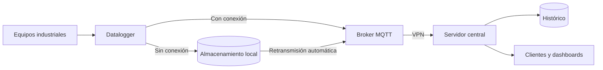

  

  

  
  
  

## 👋 Sobre mí

Construyo software que conecta el mundo físico con los datos. Diseño soluciones de monitoreo en tiempo real para entornos industriales, y también desarrollo aplicaciones web de principio a fin.

- 🏭 **Ahora:** IoT y telemetría para flotas en el sector minero.
- 🛡️ **Lo que me importa:** sistemas que siguen funcionando cuando falla la conexión.
- 🧩 **Mi experiencia:** IoT, backend, frontend, infraestructura y despliegue.

## 🛠️ Tecnologías

  
   
  

  
  
  
  
  
  
  
  
  

## 📡 Cómo construyo un sistema IoT resiliente

Este es el enfoque general que aplico, simplificado:

## 💼 Experiencia

<b>Software Developer, IoT & Infrastructure</b> · Sector minero · <i>Ago 2025 – Presente</i>

 

- Diseño e implementación de una solución IoT para monitorear flotas en tiempo real.
- Datalogger para capturar variables operativas de forma continua.
- Almacenamiento local en SQLite y retransmisión automática ante caídas de conectividad.
- Microservicios de reconexión automática y tolerancia a fallos.
- Administración del broker MQTT y del servidor central de ingestión, histórico y redistribución de datos.
- Despliegue con Docker y comunicaciones seguras mediante VPN.

<b>Full Stack Developer</b> · Grupo de Negocios Corporativos Comerciales E.I.R.L. · <i>Jul 2024 – Jul 2025</i>

 

- Sistema de gestión clínica con Laravel, React y MySQL.
- Digitalización del 100 % de las historias clínicas físicas.
- Reducción del 40 % en los tiempos de búsqueda.
- Generación automática de documentos médicos en PDF.
- Configuración y despliegue en Windows Server (IIS).

<b>Web Developer</b> · Centro Cómputo Corporación S.A.C. · <i>Jul 2023 – Dic 2024</i>

 

- Plataformas web con Astro, React y Next.js.
- Optimización del rendimiento con SSR y lazy loading.
- Integración con CMS y soluciones en PHP.
- Mejora del 25 % en la retención de usuarios.

## 🚀 Proyectos

<table>
  <tr>
    <td width="50%" valign="top">
      <h3><a href="https://github.com/Focbri/sistemaHistorialClinico">🏥 Historial clínico</a></h3>
      Gestión de pacientes y consultas médicas, con autenticación.  
      <code>Laravel</code> <code>React</code> <code>Inertia.js</code> <code>MySQL</code>
    </td>
    <td width="50%" valign="top">
      <h3><a href="https://github.com/Focbri/Poke_API">🎮 Pokédex</a></h3>
      Reto técnico con búsqueda, filtros, detalle y favoritos.  
      <code>React</code> <code>Vite</code> <code>React Router</code>
    </td>
  </tr>
  <tr>
    <td width="50%" valign="top">
      <h3><a href="https://github.com/Focbri/podo">🦶 Pododinamic</a></h3>
      Sitio web con especialidades, cursos y contacto.  
      <code>Astro</code> <code>React</code> <code>Tailwind CSS</code>
    </td>
    <td width="50%" valign="top">
      <h3><a href="https://github.com/Focbri/GrupoNec">💻 Grupo NEC</a></h3>
      Sitio corporativo con catálogo de productos de cómputo.  
      <code>Astro</code> <code>TypeScript</code> <code>Tailwind CSS</code>
    </td>
  </tr>
</table>

## 🎓 Formación

- **Técnico en Desarrollo de Software** · SENATI (2022 – 2025)
- **Inglés, nivel intermedio** · ICPNA (2020 – 2021)

## 🐍 Mi actividad en GitHub

  <picture>
    <source media="(prefers-color-scheme: dark)" srcset="https://raw.githubusercontent.com/Focbri/Focbri/output/github-snake-dark.svg" />
    
  </picture>

  

